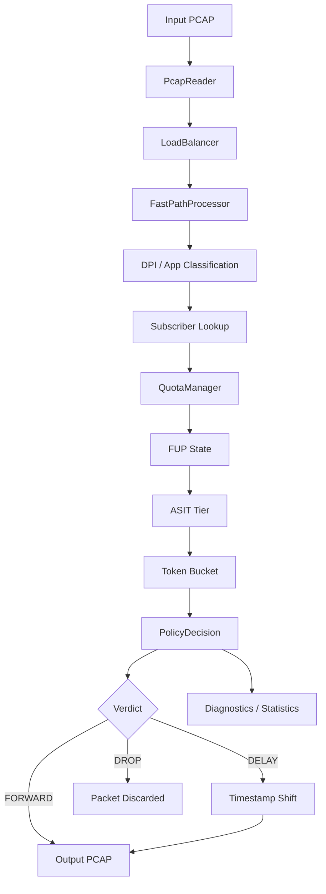
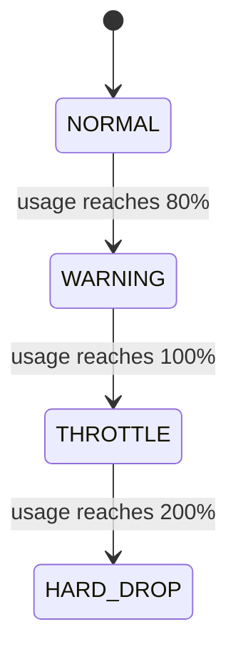

# FlowGate
**Subscriber-Aware Traffic Policy & Diagnostics Engine**


## Overview

FlowGate is a Java-based PCAP traffic-policy simulation and prototype. 
It processes offline packet captures to identify network applications and subscribers, tracks their quota usage against a Fair Usage Policy (FUP), applies application-aware throttling, and produces explainable policy decisions and diagnostics.

FlowGate is designed to be an understandable prototype for developers who know Java, focusing on observable policy enforcement.

**Built on an open-source engine.** The packet-inspection base (the `com.packetanalyzer` packages: PCAP reading, packet parsing, app identification from DNS / HTTP Host / TLS SNI, and the multi-threaded worker pipeline) follows the design of the widely shared open-source *Packet Analyzer / DPI Engine* project, originally written in C++. FlowGate adds the subscriber layer on top (the `com.flowgate` packages): quota tracking, the FUP state machine, app tiers, token-bucket shaping, explainable decisions and diagnostics.

---

## Problem Statement

When a subscriber exceeds a configured data quota, an application-aware policy can apply different limits to different types of traffic instead of treating every application equally. This is intended to protect designated essential traffic while applying stronger limits to non-essential traffic. 

FlowGate simulates an application-aware approach:
```text
Subscriber exceeds FUP quota
        ↓
Do not treat every application equally
        ↓
Essential traffic (e.g., WhatsApp, Google Pay) remains protected
Standard traffic (e.g., Google, Gmail) is throttled moderately
Entertainment traffic (e.g., Netflix, Spotify) is throttled more aggressively
```

*Note: FlowGate is an **application-aware FUP simulation using offline PCAP files**. It is not a production ISP enforcement system designed for live router integration.*

---

## Key Features

*   **Multi-threaded packet processing**
*   **Five-tuple-based flow affinity**
*   **Layer-7 application identification** (via DNS, HTTP Host, and TLS SNI where supported)
*   **Subscriber-aware quota tracking** (with support for Off-Peak hours)
*   **FUP state machine** (Normal, Warning, Throttle, Hard-Drop)
*   **ASIT application tiers** (Essential, Standard, Entertainment)
*   **Token-bucket traffic shaping** with a bounded queue: packets wait up to 500 ms, then excess traffic is dropped, so output never exceeds the tier's speed limit
*   **Uploads and downloads billed to the subscriber**: both directions of a connection go to the same worker, so a reply inherits the app found on its request
*   **`FORWARD` / `DELAY` / `DROP`** policy enforcement
*   **PCAP timestamp-based delay simulation**
*   **Explainable `PolicyDecision` + `ReasonCode`** for packets evaluated by FlowGate
*   **Evidence-based diagnostics** to explain policy effects
*   **CSV/JSON analytics/reporting**
*   **Deterministic PCAP fixtures** for testing and demonstration

---

## Architecture



Packets are read from an offline PCAP file and load-balanced to worker threads (`FastPathProcessor`) using a direction-independent 5-tuple hash, so a request and its reply land on the same worker. Workers classify applications in parallel (SNI, HTTP Host, or DNS where applicable). Shared subscriber FUP/quota evaluation is then applied in PCAP `packetId` order so cumulative usage and policy states stay deterministic. The `QuotaManager` resolves FUP state and ASIT tier, applies the Token Bucket when throttling, and produces a `PolicyDecision` (`FORWARD` / `DELAY` / `DROP`).

---

## End-to-End Packet Flow

For packets evaluated, FlowGate follows this flow:

1. Read packet from PCAP.
2. Distribute it to a processing worker (`FastPathProcessor`) based on a 5-tuple hash that is the same in both directions.
3. Parse and classify the packet (tracking TCP state and extracting SNI/DNS/Host metadata). Classification may run concurrently across workers.
4. Identify the subscriber (the source for uploads, the destination for downloads) and resolve their active plan.
5. Evaluate shared quota/FUP in PCAP packet order (usage accumulates in capture sequence unless off-peak; DPI workers may still run in parallel).
6. Determine the current FUP state (`NORMAL`, `WARNING`, `THROTTLE`, `HARD_DROP`).
7. Determine the application's ASIT tier (`ESSENTIAL`, `STANDARD`, `ENTERTAINMENT`).
8. Apply token-bucket shaping if the subscriber is throttled (non-essential traffic): send now, delay, or drop if the queue is full.
9. Produce a structured `PolicyDecision`.
10. Execute the verdict: `FORWARD` (pass normally), `DELAY` (shift the output PCAP timestamp; no thread sleep), or `DROP` (exclude from output; either the 2x-quota hard limit or a full throttle queue).
11. Update system statistics and retain the decision for the diagnostic engine.
12. Write the output packet to the new PCAP (if not dropped).

---

## FUP State Machine



*   **NORMAL**: Usage is under 80% of the configured quota. All traffic flows at full speed.
*   **WARNING**: Usage is between 80% and 100%. A warning is issued, but traffic remains at full speed.
*   **THROTTLE**: Usage reaches 100%. ASIT (App-Selective Intelligent Throttling) is activated.
*   **HARD_DROP**: Usage reaches or exceeds the configured hard-drop threshold.

---

## ASIT (App-Selective Intelligent Throttling)

During the `THROTTLE` state, FlowGate applies distinct bandwidth limits based on the application's tier.

| Tier | Example Traffic | Behavior During FUP |
| :--- | :--- | :--- |
| **ESSENTIAL** | WhatsApp, Google Pay | Protected from ASIT throttling |
| **STANDARD** | Google, Gmail | Moderate throttling (e.g., 256 Kbps) |
| **ENTERTAINMENT** | Netflix, Spotify | Stronger throttling (e.g., 64 Kbps) |

These tiers are intended to keep designated essential traffic protected from ASIT throttling while stronger limits are applied to non-essential traffic.

---

## Token Bucket

Throttling uses one token bucket per subscriber and tier (`TokenBucket`). Think of a jar of byte-tokens that refills at the tier's speed and holds one second's worth:

*   Each packet pays tokens equal to its size.
*   **Enough tokens:** the packet is sent now (`FORWARD`).
*   **Not enough:** the packet still pays, so the balance goes negative (bytes waiting in the queue). It is delayed until the bucket earns that debt back (`DELAY`). Because waiting packets pay up front, the next packet queues behind them.
*   **Wait would exceed the queue limit** (`MAX_QUEUE_DELAY_MS`, default 500 ms): the packet is dropped and its tokens are refunded (`DROP` with `THROTTLE_QUEUE_FULL`).

Result, checked in `TokenBucketTest`: a 1 Mbps stream throttled to 64 Kbps comes out at 64 Kbps (within 2%), no packet waits more than 500 ms, and traffic already under the limit is never delayed.

**FlowGate uses PCAP timestamps for time simulation**, not wall-clock time, so rate math does not depend on how fast the machine processes the file. Tokens are stored in micro-bytes so that frequent packets with tiny gaps still refill the bucket correctly.

The bucket is not thread-safe and does not need to be: `QuotaManager` evaluates one packet at a time in capture order.

*Note: the demo configuration uses tiny limits (1–2 Kbps) so a 7-packet capture shows throttling, and a 5-second queue limit so those packets show as `DELAY` rather than `DROP`.*

---

## Policy Decisions

Packets evaluated by the policy engine result in a comprehensive `PolicyDecision` record containing:
*   Subscriber IP, Plan, and FUP State
*   AppType and ASIT Tier
*   Current usage statistics
*   The final **Verdict**:
    *   `FORWARD`: Packet is written to output.
    *   `DELAY`: Packet is written to output with a simulated delay added to its PCAP timestamp.
    *   `DROP`: Packet is discarded, either because usage passed the hard-drop limit or because the throttle queue was full.
*   A **ReasonCode**: A machine-readable explanation (e.g., `FUP_QUOTA_EXCEEDED`, `THROTTLE_QUEUE_FULL`, `HARD_DROP_THRESHOLD`, `ESSENTIAL_TRAFFIC_PROTECTED`).

By generating a structured decision record, the system can transparently explain not only *what* it did, but *why* it did it.

---

## Diagnostics

The `ConnectionHealthAnalyzer` acts as an evidence-based diagnostic engine. By looking at a list of recent `PolicyDecision` records for a given subscriber, it can explain the effects of FlowGate policies on the subscriber's connection.

Supported diagnoses:
*   `HARD_DROP`: The subscriber's traffic is being dropped due to exceeding the hard-drop threshold.
*   `FUP_ENTERTAINMENT` / `FUP_STANDARD`: The subscriber is experiencing slow speeds because their quota is exhausted and the application is being actively throttled based on its tier. Packets dropped because the throttle queue was full are reported here, not as a hard drop.
*   `ESSENTIAL_PROTECTED`: The subscriber is throttled, but this specific essential application is being forwarded successfully.
*   `FUP_WARNING`: The subscriber is approaching their quota limit but is not yet throttled.
*   `IDLE`: No recent traffic data for the subscriber.
*   `HEALTHY`: No FlowGate throttling or hard-drop detected in the analyzed data.

*Note: A `NETWORK_CONGESTION` cause was considered but is currently deferred. True physical network congestion requires queue-depth telemetry or packet-loss counters sourced from hardware, which this offline simulation does not possess.*

---

## Repository Structure

```text
FlowGate/
├── config/              # Runtime configuration and policy files
│   └── demo/            # Configurations for the deterministic demo
├── samples/             # Sample PCAP files for testing
├── src/                 # Java source and test code
├── tools/               # Infrastructure scripts (generate_pcaps.py)
├── run_demo.sh          # Executable end-to-end demo script
├── pom.xml              # Maven configuration
├── README.md
├── LICENSE
└── reports/             # Generated analytics (gitignored; created at runtime)
```

---

## Build Requirements

*   **Java 21**
*   **Maven 3.x**

To compile and package the project:
```bash
mvn clean package
```
This produces an executable JAR at `target/flowgate-1.0.0.jar`.

---

## Running FlowGate

### Basic Execution (Pure DPI)
```bash
java -jar target/flowgate-1.0.0.jar input.pcap output.pcap
```

### Subscriber-Aware Execution
To enable the FlowGate FUP engine and ASIT policies, provide the configuration files:
```bash
java -jar target/flowgate-1.0.0.jar input.pcap output.pcap \
    --subscribers config/subscribers.txt \
    --throttle-policy config/throttle-policy.txt
```

### Demo
The easiest way to see FlowGate in action is via the provided shell script:
```bash
./run_demo.sh
```
This script compiles the project and processes the committed `samples/flowgate-demo.pcap` using demo-specific configurations to demonstrate the main FUP states and policy outcomes.

---

## Demo Scenario

The `samples/flowgate-demo.pcap` contains **7 × 600-byte** HTTP packets for subscriber `192.168.1.100` under an artificially tiny **2000-byte** Demo quota (WARNING ≈ 80%, THROTTLE = 100%, HARD_DROP = 200%). Demo ASIT limits are **2 Kbps** (STANDARD) and **1 Kbps** (ENTERTAINMENT).

| # | Host | Application | Tier |
|---|------|-------------|------|
| 1 | `whatsapp.com` | WhatsApp | ESSENTIAL |
| 2 | `www.google.com` | Google | STANDARD |
| 3 | `www.netflix.com` | Netflix | ENTERTAINMENT |
| 4 | `mail.google.com` | Gmail | STANDARD |
| 5 | `www.spotify.com` | Spotify | ENTERTAINMENT |
| 6 | `pay.google.com` | Google Pay | ESSENTIAL |
| 7 | `www.google.com` | Google (same 5-tuple as #2) | STANDARD |

Running `./run_demo.sh` shows runtime-derived evidence for:

*   Layer-7 identification of all six applications via **HTTP Host**
*   Cumulative quota usage progressing through **NORMAL → WARNING → THROTTLE → HARD_DROP** (600 → 4200 bytes)
*   Policy results that partition the 7 packets: **FORWARD 4 + DELAY 2 + DROP 1**
*   Same 5-tuple → same FastPath worker (packets 2 and 7)
*   Google Pay evaluated in `THROTTLE` with `FORWARD` / `ESSENTIAL_TRAFFIC_PROTECTED`
*   A subscriber diagnostic ending in `HARD_DROP`

DPI stays multi-worker with 5-tuple affinity; shared FUP evaluation is ordered by `packetId`. The report prints all seven runtime decisions.

---

## Test Strategy

FlowGate includes **64** automated JUnit tests in `src/test/java/`, focusing on core logic correctness:
*   `TokenBucketTest`: Verifies shaping: delays add up behind each other, the queue limit drops and refunds, PCAP-time refill, and that a 1 Mbps input comes out at the 64 Kbps limit.
*   `QuotaManagerTest`: Ensures FUP state transitions, tier routing, queue-full drops and upload/download billing work correctly.
*   `DownloadBillingTest`: End to end on a generated capture: replies from servers are billed to the subscriber and tagged with the app of their request.
*   `FiveTupleTest`: The flow hash is identical for both directions of a connection.
*   `SubscriberRegistryTest`: Validates file parsing and plan assignment.
*   `ThrottlePolicyTest`: Validates ASIT configurations.
*   `ConnectionHealthAnalyzerTest`: Tests the diagnostic engine's priority logic.
*   `AppTypeTest`: Guards Google Pay / Gmail classification against generic Google shadowing.
*   `DemoAppTierMappingTest`: Verifies all six demo applications map to the expected ASIT tiers.

**PCAP Fixtures:**
*   `samples/test_dpi.pcap`: A small regression fixture.
*   `samples/baseline.pcap`: A larger (5000 packet) integration/load-like testing fixture.
*   `samples/flowgate-demo.pcap`: The deterministic sequence used for the demo.
*(Note: `tools/generate_pcaps.py` is test-data generation infrastructure, not part of the production application).*

---

## Design Decisions

*   **Five-Tuple Hashing:** Load balancers distribute packets based on Source IP, Dest IP, Source Port, Dest Port, and Protocol. The hash is direction-independent, so both directions of a connection stay on the same FastPath worker and a reply can use the app identified on its request.
*   **Billing Direction:** The subscriber is whichever end of the packet is listed in the subscribers file: the source for uploads, the destination for downloads.
*   **Parallel DPI, Ordered FUP:** Classification can run on multiple workers; shared subscriber quota/FUP updates run in PCAP packet order for deterministic policy outcomes.
*   **Application Tiers (ASIT):** Distinct limits keep designated essential traffic protected from ASIT throttling during FUP enforcement.
*   **Token Bucket with a bounded queue:** Waiting packets pay for their bytes up front, so delays stack correctly and output cannot exceed the limit; anything that would wait longer than the queue limit is dropped, like a full buffer on a real link.
*   **Structured Decisions:** A `PolicyDecision` record supports analytics, debugging, and diagnostics beyond a silent drop.
*   **PCAP Timestamps:** Token Bucket refill and DELAY simulation use the packet timestamp rather than `System.currentTimeMillis()`.
*   **Offline PCAP Processing:** Allows local development and demos without a live network interface.

---

## Limitations / Scope

FlowGate is explicitly designed as a prototype and simulation. 

*   **Offline Processing:** It reads from static PCAP files rather than capturing live packets from a network interface (e.g., via AF_PACKET or DPDK).
*   **Not an ISP Gateway:** It is not designed to be deployed on real ISP edge routers. 
*   **No TLS Decryption:** Application classification depends on metadata available in the captured traffic. When required metadata is unavailable, classification may fall back to a generic or unknown application type.
*   **Artificial Demo Limits:** The quotas and bandwidth limits in the demo configuration are intentionally microscopic to force throttling observable within a few packets.
*   **Ordered FUP Accounting:** FastPath DPI stays concurrent, but `QuotaManager` applies usage/FUP updates in PCAP packet order so state transitions and essential protection are deterministic.
*   **No Genuine Congestion Telemetry:** FlowGate does not measure physical network packet loss or queue depths.

**Known gaps** (deliberately left simple):
*   Off-peak hours are computed from the PCAP timestamp in UTC, with no timezone setting.
*   The "daily" quota does not reset at midnight; usage accumulates across the whole capture.
*   An off-peak window that crosses midnight (e.g. 23:00–05:00) is not supported.
*   If neither end of a packet is a listed subscriber, the source IP is billed under the default plan.
*   Dropped packets still count towards usage (usage is added before the verdict).
*   If a worker thread failed mid-run, the ordered quota step would wait for its packet indefinitely (no timeout).

---

## What FlowGate Is / Is Not

| FlowGate is | FlowGate is not |
| :--- | :--- |
| A PCAP-based traffic-policy simulation | A production ISP gateway or router |
| A subscriber-aware policy engine | A real bandwidth enforcer on network interfaces |
| A system with explainable diagnostics | A physical network performance monitor |

---

## Future Improvements

Features **not implemented**, but logically next for an expanded scope:
*   Live interface integration (via libpcap/jNetPcap).
*   Integration of real network queue telemetry for genuine congestion detection.
*   Richer protocol classification (e.g., BitTorrent, RTP).

---

## License

[MIT License](LICENSE)
